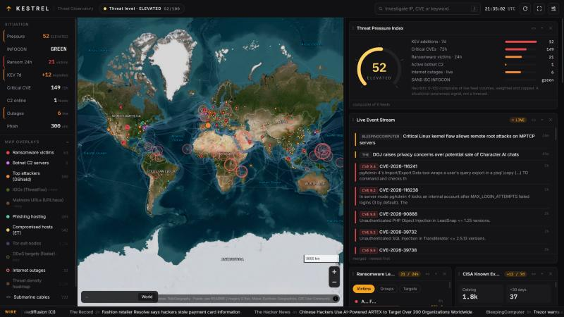
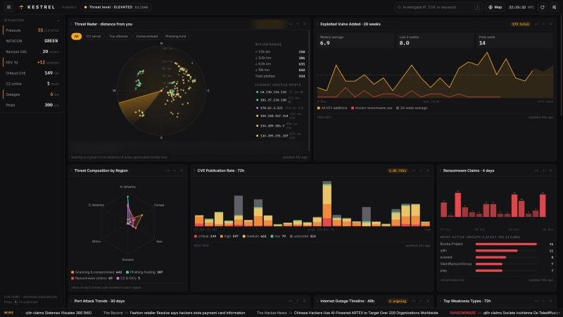

# KESTREL: Cyber Threat Observatory

KESTREL is a personal, real-time threat-intelligence dashboard that runs on your own machine. Its centrepiece is
a flat 2D satellite map (Esri World Imagery on MapLibre GL) with toggleable intel overlays: ransomware victims,
botnet C2 servers, top attacking IPs, compromised hosts, phishing infrastructure, Tor exits, internet outages,
submarine cables and a threat-density heatmap. Around it sit drag-and-drop panels for CISA KEV, fresh NVD CVEs,
ransomware leak-site activity, targeted ports, outages, a security news wire, an IP investigation tool and a
second screen of live analytics charts.

Everything runs from free OSINT sources, and **no API key is needed** for the default experience.

## Screenshots

**Screen 1 · Map**: satellite map with live threat overlays, the situation rail, Threat Pressure, the live event
stream, ransomware and CISA KEV panels.



**Screen 2 · Analytics**: Threat Radar, exploited-vulnerability trends, CVE publication rate, ransomware claims,
regional threat composition and more, all drawn from live feed data.



## Quick start

You need **Python 3.7 or newer**. There is nothing to install: the backend uses the Python standard library only.

```bash
git clone https://github.com/<your-username>/KESTREL.git
cd KESTREL
python kestrel.py
```

KESTREL starts a local web server and opens both screens in your browser:

| Screen | URL | What's on it |
| --- | --- | --- |
| 1 · Map | http://127.0.0.1:8787 | Satellite map, situation rail, Threat Pressure, Live Threat Feed, Latest Events, ransomware, CISA KEV |
| 2 · Analytics | http://127.0.0.1:8788 | Live charts plus CVEs, attackers, ports, country hotspots, C2, phishing, outages, news and IP investigation |

Press `Ctrl+C` in the terminal to stop it.

The first start takes about a minute to fully populate, because roughly 2,000 IPs are geolocated in the
background and the free geolocation API is rate limited. Markers appear on the map as they resolve. Results are
cached in `.cache/`, so later starts are much faster.

### Windows shortcuts

| Script | What it does |
| --- | --- |
| `start.bat` | Starts KESTREL in a minimised window on both ports (8787 map, 8788 analytics) and opens both pages. If it's already running, it just opens the pages |
| `stop.bat` | Stops the server and frees both ports |
| `run.bat` | Same as `start.bat` |

### Command-line options

```bash
python kestrel.py --port 9000 --analytics-port 9001   # use different ports
python kestrel.py --analytics-port 0                  # map screen only
python kestrel.py --no-browser                        # don't open browser tabs
python kestrel.py --host 0.0.0.0                      # expose on your LAN (no auth, trusted networks only)
```

## Optional API keys

KESTREL works without any keys. A few extra feeds unlock if you add free keys. **Never commit real keys.**
`config.json` is listed in `.gitignore` for this reason.

**Option A: config file.** Copy the template and fill in whichever keys you have:

```bash
cp config.example.json config.json      # Windows: copy config.example.json config.json
```

**Option B: environment variables.** These override `config.json`:

```bash
# macOS / Linux
export ABUSECH_AUTH_KEY="your-key"

# Windows PowerShell
$env:ABUSECH_AUTH_KEY = "your-key"
```

| Key in `config.json` | Env var | Unlocks | Get one |
| --- | --- | --- | --- |
| `abusech_auth_key` | `ABUSECH_AUTH_KEY` | **ThreatFox** IOC panel and layer, **URLhaus** malware URL panel and layer | Free at https://auth.abuse.ch/ |
| `nvd_api_key` | `NVD_API_KEY` | Higher NVD rate limits | https://nvd.nist.gov/developers/request-an-api-key |
| `greynoise_api_key` | `GREYNOISE_API_KEY` | Higher GreyNoise community limits | https://viz.greynoise.io/signup |

Restart KESTREL after adding a key. Keyed panels are hidden by default; turn them on in **Customise → Panels**.

You can also set your location for the Threat Radar chart in `config.json` (otherwise it uses your public-IP
location):

```json
{ "home_lat": 51.5, "home_lon": -0.12, "home_name": "London" }
```

## Using it

| Action | How |
| --- | --- |
| Switch screens | **Analytics** / **Map** button in each header (handy on two monitors) |
| Toggle a map overlay | Click it under **Map overlays** in the left rail. `L` collapses the list |
| Situation summary | The left rail lists the key numbers (pressure, INFOCON, ransomware, KEV, CVEs, C2, outages, phishing). Click one to jump to its panel |
| Watch live events | The **Live Threat Feed** panel streams items from the loaded feeds, and each one pings on the map. New items are tagged **NEW**. Filter by type, change speed, or pause (`P`) |
| Inspect a marker | Hover for a label, click for a detail card with links and an **Investigate** button |
| Jump to a location | Click any row in a panel that has a location |
| Investigate an IP | Type it in the top search box (`/` focuses it), or click **Investigate** on a marker |
| Look up a CVE | Type `CVE-2026-12345` in the search box (opens NVD and tells you if it is on CISA KEV) |
| Search the news | Type any other text in the search box to filter the Intel Wire |
| Reorder panels | Drag a panel by its `⋮⋮` grip |
| Panel controls | `⇔` full width · `▾` collapse · `✕` hide (restore from Customise) |
| Customise | Gear button or `S`: theme (Obsidian, Carbon, Midnight, Moss), panel position, columns, side rail and ticker, basemap, labels, refresh interval, panel visibility, feed health, and layout export/import |
| Other keys | `F` map focus mode · `H` fit the whole world · `P` pause the live feed · `R` refresh all feeds · `Esc` close drawer |

Layout and preference choices are saved in your browser's `localStorage`.

### Analytics charts (screen 2)

| Chart | Data |
| --- | --- |
| Threat Radar | Bearing and distance from you to every geolocated C2, attacker, compromised host, phishing host and IOC |
| Threat Composition by Region | Spider chart of where each threat type is located, by continent |
| Exploited Vulns Added | CISA KEV additions per week for 26 weeks, with ransomware-linked entries and the average |
| CVE Publication Rate | NVD CVEs published per 3 hours over 72 hours, stacked by severity |
| Ransomware Claims | Leak-site claims per 6 hours over 4 days, with the busiest group per bin |
| Port Attack Trends | 30-day SANS ISC DShield history for today's most-targeted ports |
| Internet Outage Timeline | Country outages over 48 hours; ongoing ones pulse |
| Top Weakness Types | Most common CWE classes among CVEs from the last 72 hours |

### Threat Pressure Index

The gauge is a transparent heuristic, not a prediction. It combines six live signals, each scaled against a cap
and then weighted:

| Signal | Cap | Weight |
| --- | --- | --- |
| CISA KEV additions, last 7 days | 12 | 20 |
| Critical (CVSS ≥ 9) CVEs published, last 72h | 220 | 20 |
| Ransomware leak-site victims, last 24h | 40 | 25 |
| Online botnet C2s (Feodo) | 25 | 10 |
| Ongoing country-level internet outages | 12 | 10 |
| SANS ISC INFOCON level | red | 15 |

Bands: 0–19 LOW · 20–39 GUARDED · 40–59 ELEVATED · 60–79 HIGH · 80+ SEVERE. Tweak the caps in `pressure()` in
`static/app.js`.

## Data sources (keyless)

| Feed | Used for | Refresh |
| --- | --- | --- |
| [CISA Known Exploited Vulnerabilities](https://www.cisa.gov/known-exploited-vulnerabilities-catalog) | KEV panel, pressure index | 1h |
| [NIST NVD CVE API 2.0](https://nvd.nist.gov/developers/vulnerabilities) | New CVEs in the last 72h | 30m |
| [ransomware.live](https://www.ransomware.live/) | Leak-site victims (placed at the country centroid) | 15m |
| [abuse.ch Feodo Tracker](https://feodotracker.abuse.ch/) | Botnet C2 servers | 30m |
| [SANS ISC / DShield API](https://isc.sans.edu/api/) | Top attacking IPs, targeted ports, INFOCON, port history | 30m |
| [Emerging Threats compromised IPs](https://rules.emergingthreats.net/blockrules/) | Compromised hosts layer | 30m |
| [OpenPhish community feed](https://openphish.com/) | Phishing URLs (defanged) | 30m |
| [Tor bulk exit list](https://check.torproject.org/torbulkexitlist) | Tor exit nodes layer | 6h |
| [IODA, Georgia Tech](https://ioda.inetintel.cc.gatech.edu/) | Country internet outages | 15m |
| [TeleGeography Submarine Cable Map](https://www.submarinecablemap.com/) | Cable overlay | 24h |
| RSS: The Hacker News, BleepingComputer, Krebs on Security, SANS ISC, CISA Advisories, The Record, SecurityWeek | Intel Wire, ticker, event stream | 20m |
| [CINS Army list](https://cinsscore.com/) and [Spamhaus DROP](https://www.spamhaus.org/drop/) | IP investigation matches | 1h |
| [GreyNoise Community API](https://docs.greynoise.io/) | IP investigation | on demand |
| [ip-api.com](https://ip-api.com/docs/api:batch) | IP geolocation | background |
| Esri World Imagery | Satellite basemap and labels | n/a |

## How it works

```
browser (static/)                      kestrel.py (stdlib HTTP server)
 ├─ MapLibre GL 2D map  ◄── /api/<feed> ──┤ fetch → normalise → cache (memory + .cache/*.json)
 ├─ panels + charts     ◄── /api/status ──┤ background geolocator (ip-api batch, rate-aware, cached)
 └─ localStorage prefs  ◄── /api/lookup ──┘ IP investigation (feeds + CINS + DROP + GreyNoise)
```

* The server proxies every feed, so the browser never hits CORS problems and each source is called at most once
  per refresh window, however many tabs you have open.
* If a refresh fails, the last good copy is served and marked **stale** in the panel footer.
* All feed content is HTML-escaped before rendering. Malicious URLs are defanged (`hxxp`, `[.]`) and never made
  clickable.
* On Windows, if Python can't validate a host's TLS chain, the server falls back to `curl.exe`, which uses the
  Windows certificate store.

## Notes and caveats

* ip-api's free tier is HTTP only. The IPs being geolocated are public threat-feed IPs, not yours.
* Ransomware and outage markers sit at the country centroid. IP-based markers use city-level geolocation.
* There is no authentication. Keep it on `127.0.0.1` unless you trust your network.
* The data is for situational awareness. Verify before you act on any single indicator.

## Project layout

```
kestrel.py              backend: feeds, cache, geolocation, API, static server
config.example.json     optional API keys template (copy to config.json)
data/countries.json     ISO country centroids and names
static/index.html       screen 1 (map)
static/analytics.html   screen 2 (analytics)
static/app.js           map, overlays, panels, customisation
static/charts.js        analytics charts
static/style.css        themes and layout
start.bat / stop.bat    Windows launch and stop scripts
run.bat                 alias for start.bat
docs/                   README screenshots
```
