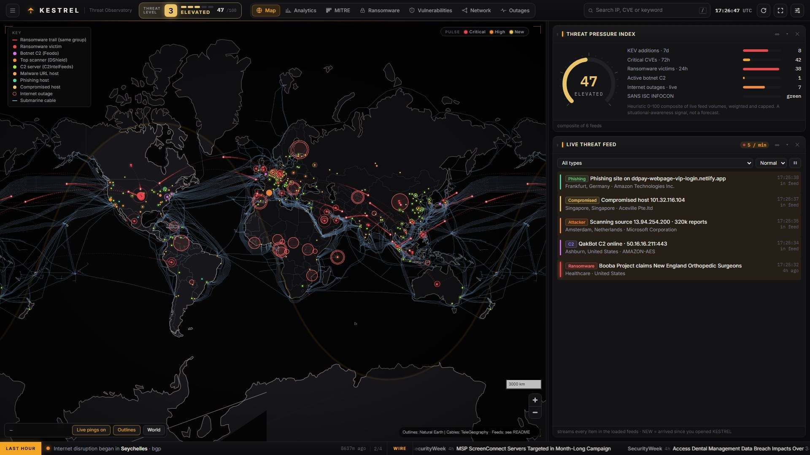
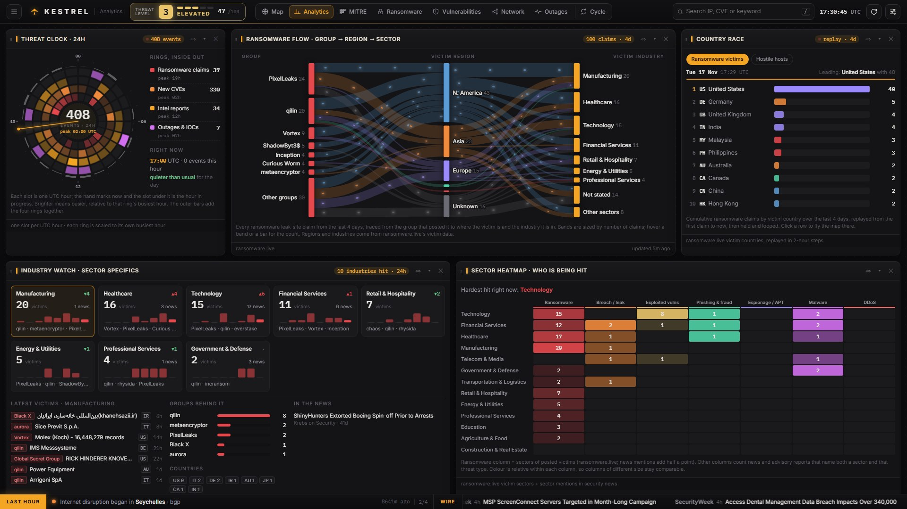
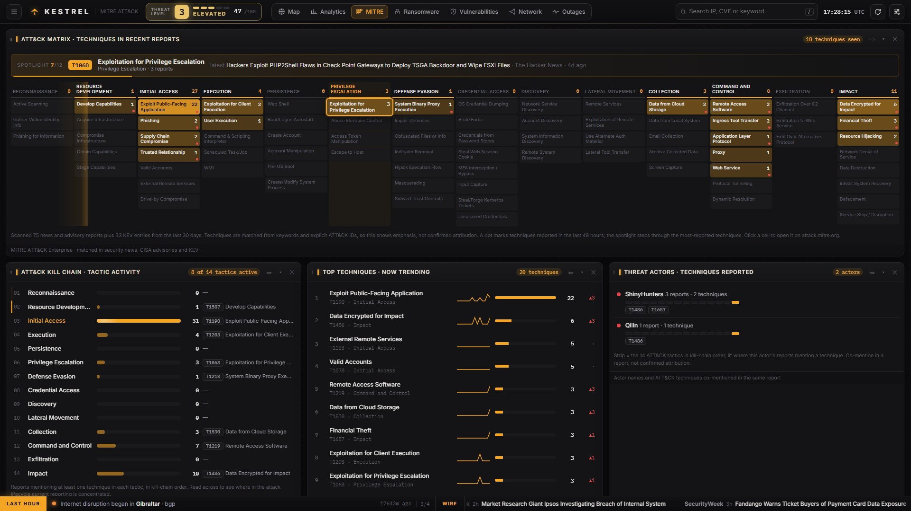

# KESTREL

KESTREL is a cyber threat intelligence dashboard that runs locally in your browser. It shows live threat data from free public sources on a world map, along with panels and charts for vulnerabilities, ransomware, attacks, outages and security news.

No API keys are needed: every feed is free and public.

## Features

- **Map view:** a flat outline world map (switch to a satellite or dark basemap with the Outlines button or `O`) with live threat layers you can toggle: ransomware victims, botnet and C2 servers, top scanners, malware URL hosts, phishing hosts, compromised hosts, Tor exit nodes, internet outages, a threat density heatmap, submarine cables and day and night shading. Severity pulses mark where critical and high events land, and live pings label each new event. There are no invented attack arcs: the only lines are ransomware campaign trails joining a group's real posted victims. Your own location is never shown.
- **Analytics view:** a 24-hour threat clock, a ransomware flow (group to victim region to industry), a country bar race, and an industry watch (which sectors are being hit, by whom, and the news behind it) at the top, and every chart below them: a threat timeline of CVEs, KEV additions, ransomware victims and advisories, a vulnerability pressure board ranked by EPSS score, an actor and campaign graph, a sector heatmap, cloud and SaaS outages (30 providers across cloud, CDN, identity, work apps, dev tools, AI and consumer services), and charts for ports, outages and weaknesses.
- **MITRE ATT&CK view:** the ATT&CK matrix with a rotating technique spotlight, plus kill-chain activity, trending techniques, actors and tagged reports.
- **Provider outage alert:** when one of the 30 monitored cloud and SaaS providers reports a major outage, a banner names every affected service across the top of the screen. Provider status is checked every minute.
- **Threat level:** a DEFCON-style level from 5 (calm) to 1 (severe) in the top bar of every screen, rolled up from the Threat Pressure Index, with its move over the last hour.
- **Last hour strip:** the bottom bar rotates through what changed in the last 60 minutes (new ransomware claims, KEV additions, critical CVEs, outages, C2 servers coming online, threat level moves), next to the news wire.
- **Story mode:** off by default. Switch it on under Customise and, when nobody has touched a screen for that many minutes, the map tours the current hotspots with captions and the other screens spotlight each panel and preset in turn. Any click or key stops it; press `T` to start it straight away.
- **Look and layout:** four themes (Obsidian by default, Carbon, Midnight and Moss), a dock you can put on the left, right or bottom and resize, panels you can drag, collapse, widen or hide, and a layout for phones and narrow screens. Open Customise with `S` or the sliders button.
- **Page presets:** buttons in the top bar for Map, Analytics, MITRE, Ransomware, Vulnerabilities, Network and Outages. The extra presets open on the analytics screen (for example `http://127.0.0.1:8788/#ransom`), each keeps its own layout, and **Cycle** can rotate through them for a wall screen (set the interval under Customise).

## Screenshots

**Map view**



**Analytics view**



**MITRE ATT&CK view**



## Requirements

- Python 3.7 or newer
- A modern web browser

There are no packages to install.

## Getting started

```bash
git clone https://github.com/<your-username>/KESTREL.git
cd KESTREL
python kestrel.py
```

The dashboard opens in your browser:

- Map view: http://127.0.0.1:8787
- Analytics view: http://127.0.0.1:8788
- MITRE ATT&CK view: http://127.0.0.1:8789

Press `Ctrl+C` in the terminal to stop it.

On Windows, you can also use `start.bat` to start the dashboard and `stop.bat` to stop it.

The first start can take a minute while data loads. After that, data is cached and loads faster.

## Keyboard shortcuts

| Key | Action |
| --- | --- |
| `/` | Search for an IP, CVE or keyword |
| `S` | Open Customise |
| `R` | Refresh all feeds |
| `F` | Map focus mode |
| `H` | Zoom the map out to the whole world |
| `O` | Switch the map between outlines and imagery (map view) |
| `L` | Show or hide the map overlay list |
| `[` | Show or hide the side rail |
| `P` | Pause or resume the live threat feed |
| `T` | Start or stop story mode |
| `Esc` | Close Customise and the side rail |

## Options

```bash
python kestrel.py --port 9000 --analytics-port 9001 --mitre-port 9002   # change the ports
python kestrel.py --analytics-port 0 --mitre-port 0                    # map view only
python kestrel.py --no-browser                                         # don't open the browser
```

## No API keys

Every feed is a free public source, so there is nothing to sign up for or paste in. `config.json` is optional and only holds settings:

| Setting | Purpose |
| --- | --- |
| `status_pages` | Extra Atlassian Statuspage providers for the outage monitor, e.g. `{"Mailgun": "https://status.mailgun.com"}` |

## Data sources

KESTREL uses public data from sources including CISA, NIST NVD, abuse.ch (Feodo Tracker and the URLhaus online list), C2IntelFeeds, SANS ISC, ransomware.live, FIRST.org EPSS, OpenPhish, the Tor Project, IODA and TeleGeography, plus a selection of security news feeds.

Actor, sector and ATT&CK technique matches are found by keyword matching in news and advisory text, so treat them as leads. The data is for general awareness only. Verify any information before acting on it.

## Project structure

```
kestrel.py            Backend server
config.example.json   Template for optional settings (no keys needed)
data/                 Country reference data
static/               Dashboard pages, scripts and styles
docs/                 Screenshots
start.bat, stop.bat   Windows start and stop scripts
```
